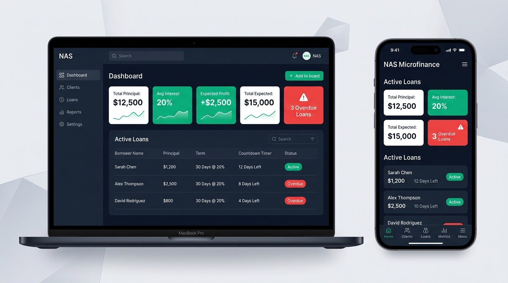
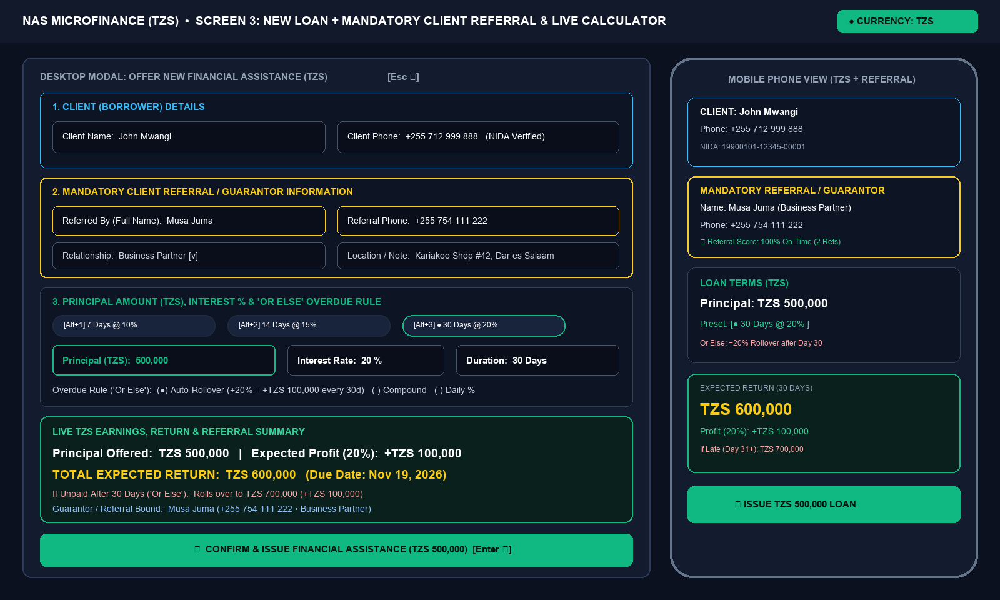
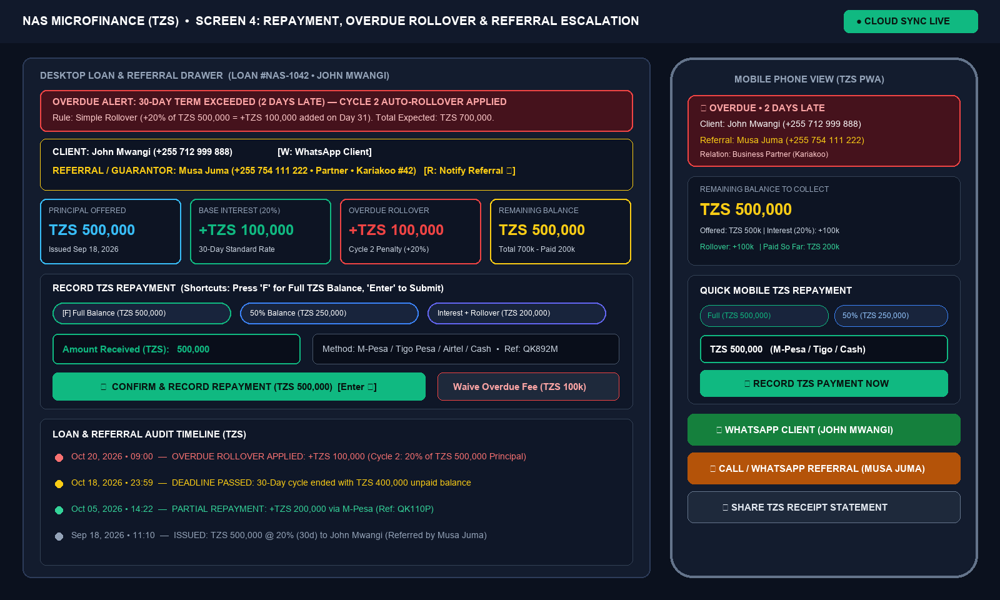
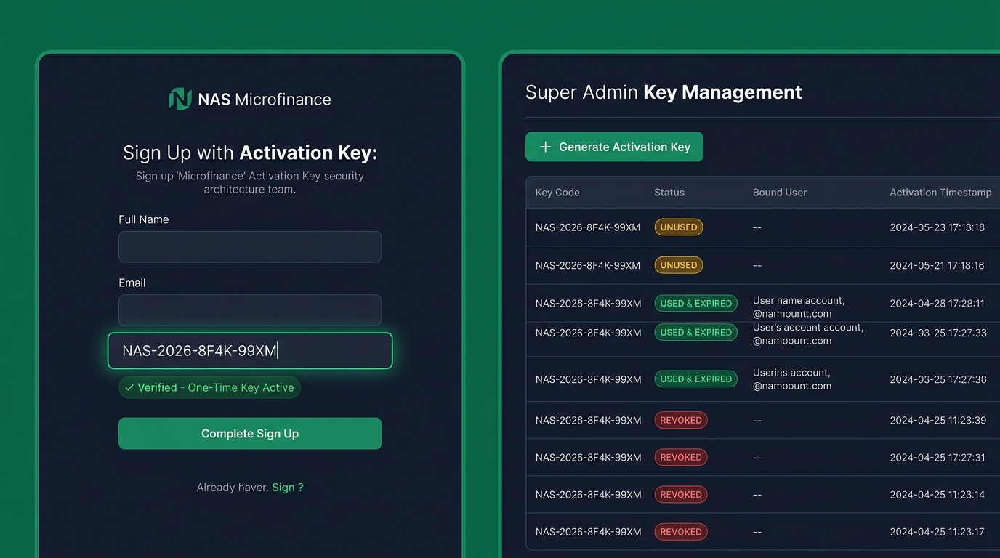

# NAS Microfinance Management System (TZS)

A cross-platform **Progressive Web App (PWA)** for managing financial assistance (loans) in **Tanzanian Shillings (`TZS`)** with **Mandatory Client Referral / Guarantor Tracking**, an automated **"Or Else" Overdue Rollover Engine**, **One-Time Activation Key Multi-User Licensing**, and **Real-Time PC-to-Phone Cloud Synchronization**.

---

## Visual UI Appearance Mockups

| Executive Dashboard (PC & Phone) | New TZS Loan + Mandatory Referral |
| :---: | :---: |
|  |  |

| Overdue Rollover & Referral Escalation | One-Time Activation Key & Super Admin |
| :---: | :---: |
|  |  |

---

## Complete Documentation Suite (`docs/`)

All formal product specifications, UI mockups, key-press/touch interaction matrices, SQL schemas, and implementation blueprints are included in the repository:
- **PDF Blueprint:** [`docs/NAS_Microfinance_Blueprint.pdf`](docs/NAS_Microfinance_Blueprint.pdf)
- **Microsoft Word Document (`.docx`):** [`docs/NAS_Microfinance_Blueprint.docx`](docs/NAS_Microfinance_Blueprint.docx)
- **Markdown Specification (`.md`):** [`docs/NAS_Microfinance_Blueprint.md`](docs/NAS_Microfinance_Blueprint.md)
- **JSON Specification (`.json`):** [`docs/NAS_Microfinance_Specification.json`](docs/NAS_Microfinance_Specification.json)

---

## Core Features

1. **Tanzanian Shilling (`TZS`) Financial & Overdue Engine (`src/lib/finance-engine.ts`):**
   - Tracks Principal Offered (`TZS`), Interest Rate `%`, Duration Days (e.g., `30 days @ 20%`), Expected Profit, and Total Return.
   - **4 Configurable "Or Else" Overdue Modes:**
     - `SIMPLE_ROLLOVER`: Automatically adds another cycle of base interest ($P \times r$) when unpaid after the due date.
     - `COMPOUND_ROLLOVER`: Applies $r\%$ onto the total unpaid balance each overdue cycle.
     - `DAILY_PENALTY`: Adds a daily late percentage fee for each day overdue.
     - `MANUAL_PENALTY`: Flags the loan in red as `OVERDUE` for manual adjustment.
   - Supports Tanzanian Mobile Money & Banking methods: **M-Pesa**, **Tigo Pesa (Mixx by Yas)**, **Airtel Money**, **HaloPesa**, **Bank Transfer**, and **Cash**.
2. **Mandatory Client Referral / Guarantor Traceability:**
   - Every client requires a **Referral Full Name**, **Referral Phone Number (`+255...`)**, **Relationship**, and **Location/NIDA note**.
   - **Referral Chain Risk Alert:** Automatically warns you during loan creation if a referral has another referred client who is currently `OVERDUE`.
   - **1-Click Escalation (`Shortcut: R`):** Send a pre-filled Swahili WhatsApp notification or call the Referral/Guarantor directly when a borrower is late.
3. **Multi-User One-Time Activation Key System:**
   - Super Admin generates single-use keys (`NAS-2026-XXXX-XXXX`).
   - New lenders sign up using an unused key; the key immediately burns (`USED`) upon account creation and isolates each lender's workspace.

---

## Getting Started

```bash
# Install dependencies
npm install

# Run automated TZS financial & referral unit tests
npm test

# Start the development server (PC & Mobile network accessible)
npm run dev

# Build for production
npm run build
```
