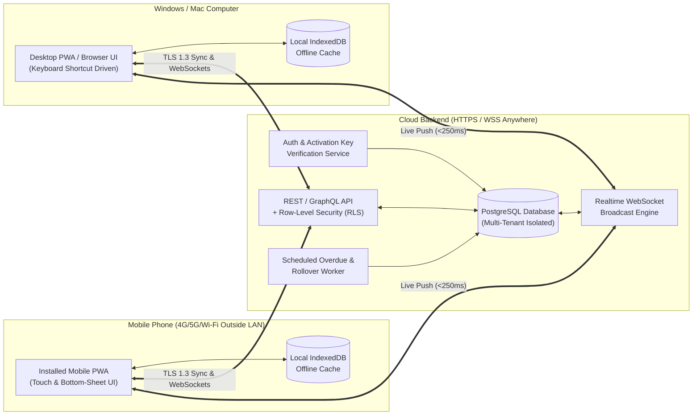
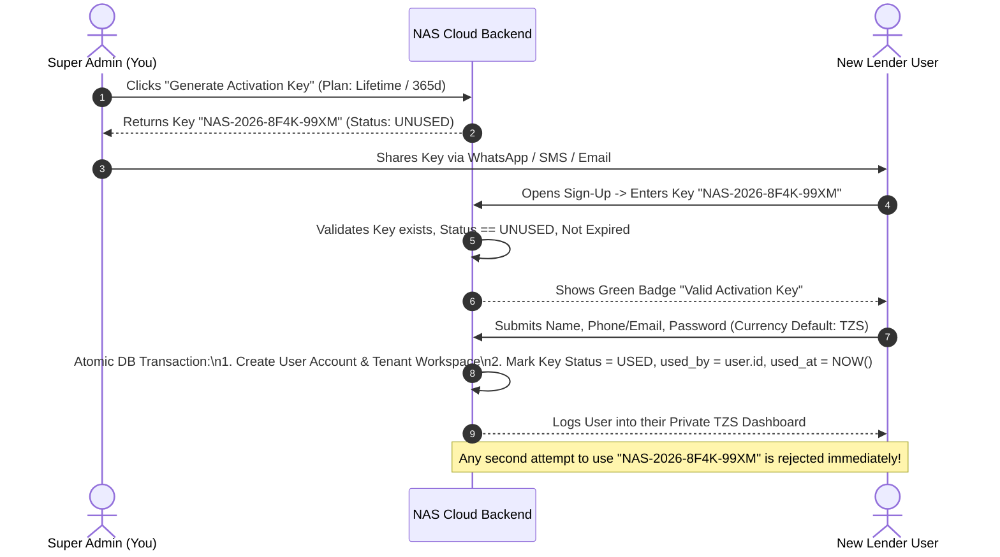

# NAS Microfinance Management System
## Complete Product Specification, UI/UX Appearance Mockups, Interaction Matrix & Step-by-Step Implementation Blueprint

- **Document Version:** 1.1.0 (Updated with **TZS Currency** & **Mandatory Client Referral / Guarantor Tracking**)
- **Date:** October 20, 2026
- **Primary Currency:** Tanzanian Shilling (**TZS**)
- **Platform Architecture:** Cross-Platform Installable Progressive Web App (PWA) — Windows/Mac Desktop & iOS/Android Mobile
- **Sync Architecture:** Real-Time Cloud Sync (Outside Local Network via HTTPS/WSS) + Local IndexedDB Offline Queue
- **Licensing Model:** Multi-Tenant SaaS with Single-Use Expiring Activation Keys & Super Admin Console

---

## Table of Contents
1. [Executive Summary & Core Vision](#1-executive-summary--core-vision)
2. [System Architecture & Cross-Network PC-to-Phone Sync](#2-system-architecture--cross-network-pc-to-phone-sync)
3. [Financial & Mathematical Engine in TZS ("The Lending & Or-Else Rules")](#3-financial--mathematical-engine-in-tzs-the-lending--or-else-rules)
4. [Client & Mandatory Referral (Guarantor) Tracking Engine](#4-client--mandatory-referral-guarantor-tracking-engine)
5. [Activation Key & Multi-User Licensing Engine](#5-activation-key--multi-user-licensing-engine)
6. [Screen-by-Screen Appearance Mockups & Every Key Press / Touch Interaction](#6-screen-by-screen-appearance-mockups--every-key-press--touch-interaction)
   - [Screen 1: Login & Activation Key Onboarding](#screen-1-login--activation-key-onboarding)
   - [Screen 2: Executive Dashboard in TZS (Desktop & Mobile)](#screen-2-executive-dashboard-in-tzs-desktop--mobile)
   - [Screen 3: New Financial Assistance (Client + Referral Info & Live TZS Calculator)](#screen-3-new-financial-assistance-client--referral-info--live-tzs-calculator)
   - [Screen 4: Loan Detail, Overdue "Or Else" Rollover, Referral Escalation & Repayment Drawer](#screen-4-loan-detail-overdue-or-else-rollover-referral-escalation--repayment-drawer)
   - [Screen 5: Client & Referral Directory + Credit Risk Profile](#screen-5-client--referral-directory--credit-risk-profile)
   - [Screen 6: Super Admin Activation Key Generator & User Manager](#screen-6-super-admin-activation-key-generator--user-manager)
7. [Global Keyboard Shortcuts (Desktop) & Touch Gestures (Mobile)](#7-global-keyboard-shortcuts-desktop--touch-gestures-mobile)
8. [Complete Database Schema & Security Policies (PostgreSQL / Supabase)](#8-complete-database-schema--security-policies-postgresql--supabase)
9. [Formal Step-by-Step Implementation Blueprint](#9-formal-step-by-step-implementation-blueprint)

---

## 1. Executive Summary & Core Vision

**NAS Microfinance Management** is a high-speed, precision financial assistance and lending tracker built for Tanzanian microfinance operators and individual lenders transacting in **Tanzanian Shillings (`TZS`)**.

### Core Objectives
1. **Instant TZS Financial Visibility:** Display at a glance the **Total Principal Offered (TZS)**, **Interest Percentage (%)**, **Expected Profit (Interest to Earn in TZS)**, **Total Expected Return (TZS)**, **Realized Profit (TZS)**, and **Overdue Balances (TZS)**.
2. **Mandatory Client Referral / Guarantor Traceability:** Every client (borrower) registered or offered financial assistance must have **Referral Information** recorded (Referral Full Name, Referral Phone Number, Relationship to Client, NIDA/ID or Workplace/Location Notes). If a client becomes overdue, you can contact their referral via Call or WhatsApp in one click/tap.
3. **Seamless PC & Phone Sync Anywhere:** Work seamlessly on a desktop/laptop computer at home or the office, and automatically synchronize in real time with a mobile phone anywhere in the world (over 4G/5G/Wi-Fi outside the local network), including offline caching when internet connectivity drops.
4. **Automated Time-Bound Interest & "Or Else" Overdue Enforcement:** Issue financial assistance for a defined period and rate (e.g., **30 days at 20% interest**), track countdowns to the exact day, and automatically calculate overdue penalties or cycle rollovers when a borrower exceeds the agreed deadline.
5. **Multi-User Activation Key System:** Allow new lenders to onboard only if they possess a valid **Activation Key** generated by the Super Admin. Once used to create an account, the activation key immediately expires (`USED`) and binds to that user's isolated workspace.

---

## 2. System Architecture & Cross-Network PC-to-Phone Sync



---

## 3. Financial & Mathematical Engine in TZS ("The Lending & Or-Else Rules")

All monetary values are stored in integer/decimal **Tanzanian Shillings (`TZS`)** and formatted clearly with thousand separators (e.g., `TZS 500,000`).

### 3.1 Base Loan Calculation
Given:
- $P$ = Principal Amount Offered (e.g., `TZS 500,000`)
- $r$ = Interest Rate Percentage per cycle (e.g., `20%` = `0.20`)
- $D$ = Term Duration in Days (e.g., `30` days)
- $T_{\text{start}}$ = Issue Date

Then:
- **Expected Base Interest ($I_{\text{base}}$):**
  $$I_{\text{base}} = P \times r$$
  *(Example: $\text{TZS } 500,000 \times 0.20 = \text{TZS } 100,000$)*
- **Initial Total Expected Return ($E_{\text{initial}}$):**
  $$E_{\text{initial}} = P + I_{\text{base}} = P \times (1 + r)$$
  *(Example: $\text{TZS } 500,000 + \text{TZS } 100,000 = \text{TZS } 600,000$)*
- **Due Date ($T_{\text{due}}$):**
  $$T_{\text{due}} = T_{\text{start}} + D \text{ days}$$

### 3.2 The "Or Else" Overdue & Penalty Engine (4 Selectable Modes per Loan)
When current date $T_{\text{now}} > T_{\text{due}} + G$ (where $G$ is optional Grace Period days, default `0`) and Remaining Balance $B_{\text{rem}} > 0$:

| Mode Code | Mode Name | Formula when Overdue | Concrete TZS Example ($P=\text{TZS } 500,000, r=20\%, D=30\text{d}$, Unpaid on Day 31) |
| :--- | :--- | :--- | :--- |
| **`SIMPLE_ROLLOVER`** *(Default)* | **Fixed Principal Rollover** | Adds $P \times r$ for each new overdue cycle $k = \lceil \text{days\_overdue} / D \rceil$ | Cycle 2 adds another **+TZS 100,000** ($20\%$ of original $\text{TZS } 500\text{k}$). New Total Due = **TZS 700,000**. |
| **`COMPOUND_ROLLOVER`** | **Compound Total Rollover** | Multiplies unpaid balance $B_{\text{rem}}$ by $(1 + r)$ each new cycle | Cycle 2 adds $20\%$ of $\text{TZS } 600,000$ = **+TZS 120,000**. New Total Due = **TZS 720,000**. |
| **`DAILY_PENALTY`** | **Daily Late Percentage** | Adds $P \times r_{\text{daily}} \times \text{days\_overdue}$ | At $1\%$/day overdue for 5 days: adds **+TZS 25,000**. New Total Due = **TZS 625,000**. |
| **`MANUAL_PENALTY`** | **Manual Custom Penalty** | Flags loan `OVERDUE` in red; lender clicks `+ Apply Penalty` to add custom TZS fee or extend date | Lender reviews client & referral situation and applies a custom TZS fee or grace extension. |

### 3.3 Repayment Allocation Order
When a borrower makes a partial payment $M_{\text{paid}}$ (via M-Pesa, Tigo Pesa, Airtel Money, HaloPesa, Bank, or Cash):
1. First clears **Accrued Penalties / Rollover Fees** ($F_{\text{penalty}}$)
2. Next clears **Expected Base Interest** ($I_{\text{base}}$) -> *Increments your Realized Profit (TZS)*
3. Finally clears **Principal Offered** ($P$) -> *Returns capital to your Available TZS Pool*

$$\text{Remaining Balance } (B_{\text{rem}}) = (P + I_{\text{base}} + F_{\text{penalty}}) - \sum M_{\text{paid}}$$

---

## 4. Client & Mandatory Referral (Guarantor) Tracking Engine

To protect your capital, **every client record requires Referral Information** before a loan can be issued:

| Field | Requirement | Description & Purpose |
| :--- | :--- | :--- |
| **Referral Type** | Required | Either **Existing Trusted Client** (linked to an existing borrower ID) or **External Referee / Guarantor** |
| **Referral Full Name** | Required | Full legal/known name of the person who referred or guaranteed the client (e.g., *Musa Juma*) |
| **Referral Phone Number** | Required | Tanzanian phone number (`+255 7XX XXX XXX`) with instant 1-tap Call & WhatsApp integration |
| **Relationship to Client** | Required | e.g., *Colleague, Business Partner, Family Member, Existing Borrower, Employer, Neighbor* |
| **Referral NIDA / ID / Location** | Optional | National ID number, workplace, or physical address of the referral |
| **Referral Trust & Chain Analytics** | Automatic | Tracks how many clients a referral has introduced and whether those referred clients pay on time! Alerts you if a referral's previous referrals are currently `OVERDUE`. |

---

## 5. Activation Key & Multi-User Licensing Engine



---

## 6. Screen-by-Screen Appearance Mockups & Every Key Press / Touch Interaction

---

### Screen 1: Login & Activation Key Onboarding

#### Appearance Mockup (Desktop Split-Card & Mobile Full-Screen)
```text
+-----------------------------------------------------------------------------------+
|  NAS MICROFINANCE MANAGEMENT (TZS)                       [Sync: Online ●] [Theme] |
+-----------------------------------------------------------------------------------+
|                                                                                   |
|          +-------------------------------------------------------------+          |
|          |      [ Sign In ]               [ Activate New Account ]     |          |
|          +-------------------------------------------------------------+          |
|          |  STEP 1: ENTER ONE-TIME ACTIVATION KEY                      |          |
|          |  +-------------------------------------------------------+  |          |
|          |  | NAS - 2026 - 8F4K - 99XM                          [✓] |  |          |
|          |  +-------------------------------------------------------+  |          |
|          |  [✓ Valid Key: Standard Lender License • One-Time Use]      |          |
|          |                                                             |          |
|          |  STEP 2: CREATE YOUR LENDER ACCOUNT                         |          |
|          |  Full Name / Business Name:  [ NAS Microfinance TZ       ]  |          |
|          |  Phone Number or Email:      [ +255 712 000 000          ]  |          |
|          |  Primary Currency:           [ TZS (Tanzanian Shilling)  ]  |          |
|          |  Password:                   [ ••••••••••••          [👁] ]  |          |
|          |                                                             |          |
|          |  [       ACTIVATE & LAUNCH MY WORKSPACE (Enter ↵)        ]  |          |
|          +-------------------------------------------------------------+          |
|                                                                                   |
+-----------------------------------------------------------------------------------+
```

#### Every Key Press & Interaction (Screen 1)
| Step | User Action (Desktop Keyboard / Mouse) | User Action (Mobile Touch) | System Visual & Data Response |
| :--- | :--- | :--- | :--- |
| **1.1** | Press `Alt + 2` or click **[Activate New Account]** tab | Tap **[Activate New Account]** pill at top | Form slides to Activation Key onboarding view; cursor auto-focuses inside the Activation Key input box. |
| **1.2** | Type or `Ctrl + V` paste key `NAS20268F4K99XM` | Long-press -> **Paste** key from WhatsApp/SMS | Input auto-formats with hyphens (`NAS-2026-8F4K-99XM`). On the 16th character, triggers a live `POST /api/keys/verify` check. |
| **1.3** | Key validation completes (`<150ms`) | Haptic light vibration feedback on mobile | Border turns Emerald Green (`#10B981`), displays badge: `✓ Valid Key • Single-Use`. If already used, border turns Crimson Red (`#EF4444`): `✗ Key Already Used & Expired`. |
| **1.4** | Press `Tab` -> Type Business Name -> `Tab` -> Phone/Email (`+255...`) -> `Tab` -> Password | Tap each field; mobile keyboard shows `Next` button | Currency is pre-selected to **TZS (Tanzanian Shilling)**; password strength bar fills. |
| **1.5** | Press `Enter ↵` (or click **[Activate & Launch]**) | Tap **[Activate & Launch My Workspace]** | Runs atomic transaction (creates account + marks key `USED`), stores session, and transitions to **Screen 2 (Dashboard)**. |

---

### Screen 2: Executive Dashboard in TZS (Desktop & Mobile)

#### Desktop Appearance Mockup (1440x900 Viewport)
```text
+--------------------+-----------------------------------------------------------------------------+
| NAS MICROFINANCE   |  Search client, referral, phone... (Ctrl+K)        [● Synced] [+ New Loan]  |
|--------------------|-----------------------------------------------------------------------------|
| ● Dashboard    [D] |  FINANCIAL OVERVIEW (OCTOBER 2026 • TZS)           Filter: [Active Cycle v] |
| ○ Loans        [L] |  +-------------------+ +-------------------+ +-------------------+ +-------+|
| ○ Clients/Ref  [B] |  | PRINCIPAL OFFERED | | EXPECTED PROFIT   | | TOTAL EXPECTED    | |OVERDUE||
| ○ Repayments   [P] |  | TZS 12,500,000    | | +TZS 2,500,000    | | TZS 15,000,000    | |1.8M TZ||
| ○ Calculator   [C] |  | 14 Active Loans   | | Avg Rate: 20.0%   | | Collected: 4.2M   | |2 Loans||
| ○ Reports      [R] |  +-------------------+ +-------------------+ +-------------------+ +-------+|
|--------------------|                                                                             |
| ADMIN              |  ACTIVE FINANCIAL ASSISTANCE & REFERRALS           [All] [Due Soon] [Late]  |
| ○ Activ. Keys  [K] |  +------------------------------------------------------------------------+ |
| ○ Settings     [S] |  | CLIENT & REFERRAL   | OFFERED     | RATE/TERM | EXPECTED    | DUE IN   | |
|                    |  |---------------------|-------------|-----------|-------------|----------| |
|                    |  | John M. (+255712..) | TZS 500,000 | 20% / 30d | TZS 600,000 | OVERDUE  | |
|                    |  | Ref: Musa J. (0754..|             | +100k Roll| (TZS 700k)  | [Pay][💬]| |
|                    |  |---------------------|-------------|-----------|-------------|----------| |
|                    |  | Sarah K. (+255754..)| TZS 1,500k  | 20% / 30d | TZS 1,800k  | 4 Days   | |
|                    |  | Ref: Asha R. (0784..|             | +300k Int.| Rem: 1,200k | [Pay][💬]| |
+--------------------+-----------------------------------------------------------------------------+
```

#### Mobile Phone Appearance Mockup (390x844 Portrait Viewport)
```text
+---------------------------------------+
| NAS Microfinance    [● Synced] [🔔 2] |
+---------------------------------------+
|  TOTAL EXPECTED COLLECTION (TZS)      |
|  TZS 15,000,000                       |
|  Offered: 12,500,000 | Profit: +2.5M  |
|  Avg Interest: 20%   | Overdue: 1.8M  |
+---------------------------------------+
|  [All (14)] [Overdue (2)] [Due Soon]  |
+---------------------------------------+
|  🔴 JOHN M.             DUE: 2d AGO   |
|  Ref by: Musa J. (+255 754 111 222)   |
|  Offered: TZS 500,000 • 20% (30 Days) |
|  Expected: 600,000 -> Rollover: 700k  |
|  [ Record Pay ] [Client 💬] [Ref 📞]  |
|---------------------------------------|
|  🟡 SARAH K.            DUE: IN 4d    |
|  Ref by: Asha R. (+255 784 333 444)   |
|  Offered: TZS 1,500,000 • 20% (30d)   |
|  Expected: TZS 1,800,000              |
|  [ Record Pay ] [Client 💬] [View ->] |
+---------------------------------------+
|                   (+)                 | <- Floating Action Button (New Loan)
|  [🏠 Home] [📄 Loans] [👥 People] [🔑] | <- Sticky Bottom Navigation Bar
+---------------------------------------+
```

#### Every Key Press & Interaction (Screen 2)
| Action Goal | Desktop Keyboard / Mouse Action | Mobile Phone Touch Action | System Behavior |
| :--- | :--- | :--- | :--- |
| **Search by Client OR Referral** | Press `Ctrl + K` or `/` -> type client name, phone, or **referral name/phone** | Tap magnifying glass icon at top right | Instantly filters loans not only by the borrower, but also by **who referred them** (e.g., typing `"Musa"` shows all clients referred by Musa J.). |
| **Open "New Loan" Modal** | Press `N` or click **[+ New Loan]** | Tap the emerald floating `(+)` button at bottom right | Opens **Screen 3 (New Financial Assistance)** modal/bottom-sheet. |
| **Contact Referral on Overdue Loan** | Focus row (`J`/`K`) -> Press `R` (Contact Referral) or click `Ref:` link | Tap `[Ref 📞]` on the loan card | Opens quick action to Call or WhatsApp the **Referral / Guarantor** with a polite message informing them their referred client's assistance is overdue. |

---

### Screen 3: New Financial Assistance (Client + Referral Info & Live TZS Calculator)

#### Appearance Mockup (Desktop Modal & Mobile Slide-Up Sheet)
```text
+-----------------------------------------------------------------------+
|  OFFER NEW FINANCIAL ASSISTANCE (LOAN IN TZS)                 [Esc ✕] |
+-----------------------------------------------------------------------+
|  1. CLIENT (BORROWER) INFORMATION                                     |
|  Client Full Name:       [ John Mwangi                 ] [Existing v] |
|  Client Phone Number:    [ +255 712 999 888            ]              |
|  NIDA / ID / Collateral: [ NIDA: 19900101-12345-00001  ]              |
|                                                                       |
|  2. MANDATORY REFERRAL / GUARANTOR INFORMATION                        |
|  Referred By (Name):     [ Musa Juma                   ] [Pick Client]|
|  Referral Phone Number:  [ +255 754 111 222            ]              |
|  Relationship to Client: [ Business Partner         [v]]              |
|  Referral Location/Note: [ Kariakoo Shop #42, DSM      ]              |
|                                                                       |
|  3. PRINCIPAL & INTEREST TERMS (TZS)                                  |
|  Quick Presets:  [ 7d @ 10% ]  [ 14d @ 15% ]  [● 30d @ 20% ] [Custom] |
|  Principal Offered (TZS): [ 500,000             ]                     |
|  Interest Rate (%):       [ 20                  ] %                   |
|  Duration (Days):         [ 30                  ] Days                |
|                                                                       |
|  4. "OR ELSE" OVERDUE RULE (IF UNPAID AFTER 30 DAYS)                  |
|  (●) Auto-Rollover (+20% of Principal = +TZS 100,000 every 30 days)   |
|  ( ) Compound Rollover (+20% of Unpaid Balance = +TZS 120,000)        |
|  ( ) Daily Late Penalty ( [ 1.0 ] % per day overdue )                 |
|  ( ) Manual Flag Only (Alert me in red, I will decide penalty)        |
|                                                                       |
|  +-----------------------------------------------------------------+  |
|  | LIVE TZS EARNINGS & RETURN PREVIEW                              |  |
|  | Principal Offered:     TZS 500,000                              |  |
|  | Expected Profit (20%): +TZS 100,000                             |  |
|  | TOTAL EXPECTED RETURN: TZS 600,000 (Due Nov 19, 2026)           |  |
|  | If Late (Day 31+):     Becomes TZS 700,000 (+20% Rollover)      |  |
|  | Guarantor / Referral:  Musa Juma (+255 754 111 222 • Partner)   |  |
|  +-----------------------------------------------------------------+  |
|                                                                       |
|  [ Cancel (Esc) ]                 [ Confirm & Issue TZS Loan (↵) ]    |
+-----------------------------------------------------------------------+
```

#### Every Key Press & Interaction (Screen 3)
| Step | Desktop Keyboard / Mouse Action | Mobile Phone Touch Action | Live Calculation & UI Update |
| :--- | :--- | :--- | :--- |
| **3.1** | Type Client Name & Phone (`+255...`) -> press `Tab` | Tap Client fields -> enter name & phone | If existing client is picked, auto-populates their saved Referral Information so you don't have to re-type it! |
| **3.2** | Fill **Mandatory Referral Information**: Referral Name -> `Tab` -> Referral Phone (`+255...`) -> `Tab` -> Relationship (`Up/Down` arrows: *Colleague, Family, Business Partner, Existing Client, Employer*) -> `Tab` -> Referral Location/Notes | Tap Referral fields (or tap `[Pick Existing Client]` if referred by an existing borrower) | Checks if this Referral has referred other borrowers before and shows a badge (e.g., `✓ Reliable Referral: 2 past referrals paid 100% on time`, or a warning `⚠ 1 client referred by Musa is currently Overdue!`). |
| **3.3** | Press `Tab` to **Principal Offered (TZS)** -> type `500000` | Tap **Principal Offered (TZS)** -> numeric keypad opens -> tap `500000` | Auto-formats with commas (`500,000`) and updates the **Live TZS Earnings & Return Preview** on every keystroke (`Expected Profit: +TZS 100,000`, `Total Return: TZS 600,000`). |
| **3.4** | Press `Alt + 3` (`30d @ 20%`) or enter custom `%` & `Days`, and select the **"Or Else" Overdue Rule** | Tap preset pill `[30d @ 20%]` and tap desired Overdue Rule card | Preview box shows both the standard due amount (`TZS 600,000`) and the exact Day 31+ "Or Else" rollover amount (`TZS 700,000`). |
| **3.5** | Press `Enter ↵` | Tap **[Confirm & Issue TZS Loan]** | Validates that Client & Referral details are present, commits loan to DB, updates Dashboard KPIs, syncs across PC & Phone, and offers a 1-click **TZS Loan Receipt (with Client & Referral details)**. |

---

### Screen 4: Loan Detail, Overdue "Or Else" Rollover, Referral Escalation & Repayment Drawer

#### Appearance Mockup (Desktop Right Drawer & Mobile Full Screen)
```text
+-----------------------------------------------------------------------+
|  ← Back (Esc)       LOAN #NAS-1042 • JOHN MWANGI      [Share Receipt] |
+-----------------------------------------------------------------------+
|  🔴 STATUS: OVERDUE (CYCLE 2 - AUTO ROLLOVER APPLIED)                 |
|  Original Due: Oct 18, 2026 (2 Days Ago) • Next Rollover: Nov 17      |
+-----------------------------------------------------------------------+
|  CLIENT & MANDATORY REFERRAL / GUARANTOR CARD                         |
|  • Client:   John Mwangi (+255 712 999 888)      [Call 📞] [WhatsApp] |
|  • Referral: Musa Juma (+255 754 111 222)        [Call 📞] [Notify 💬]|
|    Relation: Business Partner • Location: Kariakoo Shop #42, DSM      |
+-----------------------------------------------------------------------+
|  FINANCIAL BREAKDOWN (TZS)                                            |
|  +--------------------+--------------------+-----------------------+  |
|  | Principal Offered  | Base Interest (20%)| Overdue Rollover (+20%|  |
|  | TZS 500,000        | +TZS 100,000       | +TZS 100,000 (Cycle 2)|  |
|  +--------------------+--------------------+-----------------------+  |
|  | Total Expected: TZS 700,000  | Paid So Far: TZS 200,000         |  |
|  | REMAINING BALANCE TO COLLECT: TZS 500,000                       |  |
|  +-----------------------------------------------------------------+  |
|                                                                       |
|  RECORD A REPAYMENT (TZS)                                             |
|  Quick Fill: [ Full (TZS 500,000) ] [ 50% (250,000) ] [ Int (100k) ]  |
|  Amount Received (TZS): [ 500,000          ] Method: [ M-Pesa     v ] |
|  Receipt / Ref ID:      [ M-Pesa QK892M... ]                          |
|  [          ✓ RECORD PAYMENT OF TZS 500,000 (Enter ↵)              ]  |
+-----------------------------------------------------------------------+
```

#### Every Key Press & Interaction (Screen 4)
| Action Goal | Desktop Keyboard / Mouse Action | Mobile Phone Touch Action | System Behavior |
| :--- | :--- | :--- | :--- |
| **Pay Full TZS Balance in 1 Step** | Press `F` (Full Balance shortcut) then `Enter ↵` | Tap `[Full (TZS 500,000)]` pill then tap **[✓ Record Payment]** | Auto-fills `500,000`, marks loan as **`PAID / SETTLED`**, and moves expected profit into **Realized Profit (TZS)**. |
| **Record Partial Repayment (M-Pesa / Tigo Pesa / Airtel / Cash)** | Type partial TZS amount -> select Payment Method (`M-Pesa`, `Tigo Pesa`, `Airtel Money`, `Bank`, `Cash`) -> press `Enter ↵` | Tap `Amount Received` -> type TZS amount -> tap **[✓ Record Payment]** | Deducts payment from Remaining Balance, logs the mobile money transaction reference in the Audit Timeline, and updates PC and Phone immediately. |
| **Escalate to Referral / Guarantor** | Press `R` or click `[Notify 💬]` next to the Referral's name | Tap `[Notify 💬]` or `[Call 📞]` on the Referral card | Opens WhatsApp/Dialer directed to the **Referral (`Musa Juma`)** with a pre-filled Swahili/English template: *"Habari Musa Juma, tunakutaarifu kuwa mkopo wa John Mwangi (TZS 500,000) uliyemdhamini umevuka muda wake..."* |

---

### Screen 5: Client & Referral Directory + Credit Risk Profile

#### Appearance Mockup
```text
+---------------------------------------------------------------------------------------+
|  CLIENTS & REFERRALS DIRECTORY (24)          [Search Client or Referral...] [+ Client]|
+---------------------------------------------------------------------------------------+
|  CLIENT NAME & PHONE | REFERRED BY (GUARANTOR) | ACTIVE LOAN   | PROFIT EARNED| SCORE |
|----------------------|-------------------------|---------------|--------------|-------|
|  Sarah K.            | Asha R. (Colleague)     | TZS 1,500,000 | +TZS 900,000 | 🟢 A+ |
|  +255 754 000 111    | +255 784 333 444        | Due in 4d     | (3 Loans)    | 98%   |
|----------------------|-------------------------|---------------|--------------|-------|
|  John Mwangi         | Musa Juma (Partner)     | TZS 500,000   | +TZS 100,000 | 🔴 C  |
|  +255 712 999 888    | +255 754 111 222        | 2d OVERDUE    | (1 Rollover) | 45%   |
+---------------------------------------------------------------------------------------+
```

---

### Screen 6: Super Admin Activation Key Generator & User Manager

#### Appearance Mockup
```text
+-----------------------------------------------------------------------------------+
|  🔑 SUPER ADMIN: ACTIVATION KEYS & USER LICENSING          [+ Generate New Key]   |
+-----------------------------------------------------------------------------------+
|  GENERATE ONE-TIME ACTIVATION KEY                                                 |
|  License Tier: [ Standard Lender (Unlimited TZS Loans) v ]                        |
|  Account Validity After Activation: [ Lifetime Access v ] (or 30d / 90d / 365d)   |
|  Key Claim Window (Before Use):     [ 7 Days          v ]                         |
|  Note / Issued For:                 [ Client: David M. ]  [ ⚡ Generate Key (G) ]  |
+-----------------------------------------------------------------------------------+
|  GENERATED KEYS LOG                                                               |
|  KEY CODE            | STATUS       | ISSUED TO / CLAIMED BY  | ACTIVATED AT      |
|----------------------|--------------|-------------------------|-------------------|
|  NAS-2026-9X2P-44LM  | 🟢 UNUSED    | Note: Client David M.   | Waiting for claim |
|                      |              | [📋 Copy Key] [Share 💬]| [Revoke]          |
|----------------------|--------------|-------------------------|-------------------|
|  NAS-2026-8F4K-99XM  | ⚫ USED      | david@example.com       | Oct 20, 2026 13:40|
|                      | (Expired Key)| Workspace: Active (TZS) | [Suspend User]    |
+-----------------------------------------------------------------------------------+
```

---

## 7. Global Keyboard Shortcuts (Desktop) & Touch Gestures (Mobile)

| Shortcut Key | Context | Exact Action |
| :--- | :--- | :--- |
| `Ctrl + K` or `/` | Global | Focus instant search (searches Client Name, Client Phone, **Referral Name**, or **Referral Phone**) |
| `N` | Global (outside inputs) | Open **New Financial Assistance (TZS Loan)** modal |
| `P` | Dashboard / Loan Row | Open **Record TZS Repayment** modal for selected loan |
| `W` | Focused Loan Row / Drawer | Send WhatsApp reminder to **Client (Borrower)** |
| `R` | Focused Loan Row / Drawer | Call or WhatsApp the **Client's Referral / Guarantor** |
| `D` / `L` / `B` / `K` | Global | Jump to **Dashboard** (`D`), **Loans** (`L`), **Borrowers & Referrals** (`B`), or **Admin Keys** (`K`) |
| `O` | Dashboard / Loans | Toggle filter for **Overdue ("Or Else") Loans Only** |
| `Alt + 1 / 2 / 3` | Inside New Loan Modal | Apply Loan Preset 1 (`7d @ 10%`), Preset 2 (`14d @ 15%`), or Preset 3 (`30d @ 20%`) |
| `F` | Inside Repayment Modal | Auto-fill **100% Full Remaining TZS Balance** |
| `J` / `K` or `↓` / `↑` | Tables & Lists | Move highlight cursor down / up through loans or clients |
| `Enter ↵` / `Esc` | Modals & Forms | Submit active form (`Enter`) or close active modal/drawer (`Esc`) |

---

## 8. Complete Database Schema & Security Policies (PostgreSQL / Supabase)

```sql
-- 1. PROFILES / TENANTS TABLE (DEFAULT CURRENCY: TZS)
CREATE TABLE profiles (
    id UUID PRIMARY KEY REFERENCES auth.users(id) ON DELETE CASCADE,
    business_name TEXT NOT NULL,
    email_or_phone TEXT NOT NULL,
    role TEXT NOT NULL DEFAULT 'LENDER' CHECK (role IN ('SUPER_ADMIN', 'LENDER')),
    default_currency TEXT NOT NULL DEFAULT 'TZS',
    default_interest_rate NUMERIC(5,2) NOT NULL DEFAULT 20.00,
    default_duration_days INTEGER NOT NULL DEFAULT 30,
    account_status TEXT NOT NULL DEFAULT 'ACTIVE' CHECK (account_status IN ('ACTIVE', 'SUSPENDED', 'EXPIRED')),
    license_expires_at TIMESTAMPTZ,
    created_at TIMESTAMPTZ NOT NULL DEFAULT NOW()
);

-- 2. ACTIVATION KEYS TABLE (ONE-TIME USE)
CREATE TABLE activation_keys (
    id UUID PRIMARY KEY DEFAULT gen_random_uuid(),
    key_code TEXT UNIQUE NOT NULL, -- e.g. 'NAS-2026-8F4K-99XM'
    status TEXT NOT NULL DEFAULT 'UNUSED' CHECK (status IN ('UNUSED', 'USED', 'EXPIRED', 'REVOKED')),
    plan_name TEXT NOT NULL DEFAULT 'STANDARD_LENDER',
    validity_days INTEGER, -- NULL means Lifetime access once activated
    claim_expires_at TIMESTAMPTZ,
    notes TEXT,
    created_by UUID REFERENCES profiles(id),
    used_by UUID REFERENCES profiles(id),
    used_at TIMESTAMPTZ,
    created_at TIMESTAMPTZ NOT NULL DEFAULT NOW()
);

-- 3. BORROWERS (CLIENTS) TABLE WITH MANDATORY REFERRAL INFORMATION
CREATE TABLE borrowers (
    id UUID PRIMARY KEY DEFAULT gen_random_uuid(),
    user_id UUID NOT NULL REFERENCES profiles(id) ON DELETE CASCADE,
    full_name TEXT NOT NULL,
    phone_number TEXT NOT NULL,
    national_id TEXT,
    collateral_notes TEXT,
    -- MANDATORY REFERRAL / GUARANTOR FIELDS
    referral_name TEXT NOT NULL,
    referral_phone TEXT NOT NULL,
    referral_relationship TEXT NOT NULL, -- e.g., 'Business Partner', 'Colleague', 'Family', 'Existing Client'
    referral_location_or_id TEXT,
    referred_by_borrower_id UUID REFERENCES borrowers(id) ON DELETE SET NULL, -- Optional link if referred by existing client
    trust_score INTEGER NOT NULL DEFAULT 100,
    created_at TIMESTAMPTZ NOT NULL DEFAULT NOW(),
    updated_at TIMESTAMPTZ NOT NULL DEFAULT NOW()
);

-- 4. LOANS (FINANCIAL ASSISTANCE IN TZS) TABLE
CREATE TABLE loans (
    id UUID PRIMARY KEY DEFAULT gen_random_uuid(),
    user_id UUID NOT NULL REFERENCES profiles(id) ON DELETE CASCADE,
    borrower_id UUID NOT NULL REFERENCES borrowers(id) ON DELETE RESTRICT,
    currency TEXT NOT NULL DEFAULT 'TZS',
    principal_amount NUMERIC(15,2) NOT NULL CHECK (principal_amount > 0),
    interest_rate_percent NUMERIC(6,2) NOT NULL CHECK (interest_rate_percent >= 0),
    duration_days INTEGER NOT NULL CHECK (duration_days > 0),
    issue_date DATE NOT NULL DEFAULT CURRENT_DATE,
    due_date DATE NOT NULL,
    overdue_rule TEXT NOT NULL DEFAULT 'SIMPLE_ROLLOVER'
        CHECK (overdue_rule IN ('SIMPLE_ROLLOVER', 'COMPOUND_ROLLOVER', 'DAILY_PENALTY', 'MANUAL_PENALTY')),
    daily_penalty_percent NUMERIC(5,2) DEFAULT 0.00,
    grace_period_days INTEGER NOT NULL DEFAULT 0,
    expected_base_interest NUMERIC(15,2) NOT NULL,
    accrued_penalty_amount NUMERIC(15,2) NOT NULL DEFAULT 0.00,
    rollover_cycles_count INTEGER NOT NULL DEFAULT 0,
    total_expected_return NUMERIC(15,2) NOT NULL,
    amount_paid NUMERIC(15,2) NOT NULL DEFAULT 0.00,
    remaining_balance NUMERIC(15,2) NOT NULL,
    status TEXT NOT NULL DEFAULT 'ACTIVE'
        CHECK (status IN ('ACTIVE', 'DUE_SOON', 'OVERDUE', 'PAID', 'DEFAULTED')),
    notes TEXT,
    created_at TIMESTAMPTZ NOT NULL DEFAULT NOW(),
    updated_at TIMESTAMPTZ NOT NULL DEFAULT NOW()
);

-- 5. REPAYMENTS TABLE (SUPPORTS M-PESA, TIGO PESA, AIRTEL MONEY, HALOPESA, BANK, CASH)
CREATE TABLE repayments (
    id UUID PRIMARY KEY DEFAULT gen_random_uuid(),
    user_id UUID NOT NULL REFERENCES profiles(id) ON DELETE CASCADE,
    loan_id UUID NOT NULL REFERENCES loans(id) ON DELETE CASCADE,
    amount NUMERIC(15,2) NOT NULL CHECK (amount > 0),
    payment_method TEXT NOT NULL DEFAULT 'M_PESA'
        CHECK (payment_method IN ('M_PESA', 'TIGO_PESA', 'AIRTEL_MONEY', 'HALOPESA', 'BANK_TRANSFER', 'CASH')),
    reference_note TEXT,
    paid_at TIMESTAMPTZ NOT NULL DEFAULT NOW(),
    created_at TIMESTAMPTZ NOT NULL DEFAULT NOW()
);

-- 6. ROW-LEVEL SECURITY (RLS) FOR STRICT MULTI-USER ISOLATION
ALTER TABLE profiles ENABLE ROW LEVEL SECURITY;
ALTER TABLE borrowers ENABLE ROW LEVEL SECURITY;
ALTER TABLE loans ENABLE ROW LEVEL SECURITY;
ALTER TABLE repayments ENABLE ROW LEVEL SECURITY;
ALTER TABLE activation_keys ENABLE ROW LEVEL SECURITY;

CREATE POLICY "Users manage only their own borrowers"
    ON borrowers FOR ALL USING (auth.uid() = user_id);

CREATE POLICY "Users manage only their own loans"
    ON loans FOR ALL USING (auth.uid() = user_id);

CREATE POLICY "Users manage only their own repayments"
    ON repayments FOR ALL USING (auth.uid() = user_id);
```

---

## 9. Formal Step-by-Step Implementation Blueprint

1. **Phase 1 — Project Scaffolding & PWA Foundation:** Initialize Next.js + TypeScript + Tailwind CSS + Lucide Icons in the workspace with installable Desktop/Mobile PWA manifest and offline storage (`IndexedDB`).
2. **Phase 2 — TZS Financial Engine & Client Referral Model (`src/lib/finance-engine.ts`):** Build and unit-test TZS formatting (`TZS 500,000`), interest & return math, the 4 Overdue Rollover modes, repayment allocation, and Referral Chain trust scoring.
3. **Phase 3 — Activation Key & Multi-User Auth System:** Build the Login/Activation Key onboarding flow (with atomic single-use key burn) and the Super Admin Key Generator panel.
4. **Phase 4 — Executive TZS Dashboard, Loan + Referral Modal & Repayment Drawer:** Implement all 6 screens with mandatory Referral fields, Tanzanian Mobile Money methods (`M-Pesa`, `Tigo Pesa`, `Airtel Money`, `HaloPesa`, `Cash`), and 1-tap Client/Referral WhatsApp reminders (English & Swahili templates).
5. **Phase 5 — Cloud Sync, Global Keyboard Shortcuts & Verification:** Wire up real-time cross-network cloud synchronization, global desktop shortcuts (`N`, `P`, `R`, `W`, `O`, `Ctrl+K`, etc.), and end-to-end verification.
